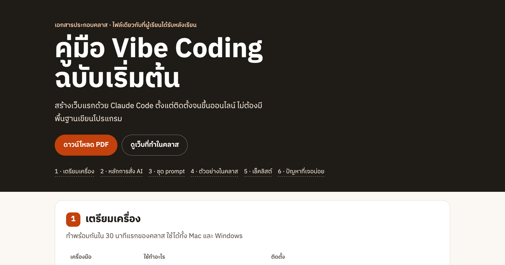

# คู่มือ Vibe Coding ฉบับเริ่มต้น

เอกสารประกอบคลาสสอนสร้างเว็บด้วย Claude Code แบบตัวต่อตัว เป็นไฟล์เดียวกับที่ผู้เรียนได้รับหลังเรียน

**เปิดอ่าน: https://vibecoding-th.vercel.app** · [ดาวน์โหลด PDF](https://vibecoding-th.vercel.app/handout.pdf) · [เว็บที่ทำในคลาส](https://vibecoding-th.vercel.app/demo/)



## ในคู่มือมีอะไร

1. **เตรียมเครื่อง** VS Code, Git, Node.js และคำสั่งติดตั้ง Claude Code จากเอกสารทางการ
2. **5 หลักการสั่ง AI ให้ได้งาน** บอกให้ครบ, วางแผนก่อน, ทีละเรื่อง, ให้หลักฐาน, เซฟงานบ่อย
3. **ชุด prompt 12 อัน** มีปุ่มคัดลอก ตั้งแต่เริ่มโปรเจกต์ แก้บั๊ก ย้อนกลับ ไปจนถึงเช็คความปลอดภัย
4. **ตัวอย่างในคลาส** เว็บร้านเทียนหอม (ร้านสมมติ) ที่สร้างด้วย Claude Code ตาม prompt ทีละขั้น 6 ขั้น
5. **เช็คลิสต์ก่อนเชื่อ AI**
6. **ปัญหาที่เจอบ่อยและวิธีแก้**

## ตัวอย่างในคลาส: 1 prompt = 1 commit

โค้ดของเว็บตัวอย่างอยู่ใน [`public/demo/`](public/demo/) และทุกขั้นถูกเก็บเป็น commit แยก
ข้อความ commit คือ prompt ที่ใช้จริง เปิดดูได้ว่าแต่ละ prompt เปลี่ยนโค้ดอะไรบ้าง:

| ขั้น | Prompt | ผล |
|---|---|---|
| 1 | สร้างเว็บหน้าเดียว 3 ไฟล์ ให้ดูดีบนมือถือก่อน บอกแผนก่อนเขียน | หน้าแรก 5 ส่วน |
| 2 | ปรับโทนครีม / เขียวเซจ ฟอนต์ไทยจาก Google Fonts | ดีไซน์ใหม่ |
| 3 | เพิ่มตะกร้า นับจำนวน ยอดรวม ส่งสรุปเข้า LINE | ตะกร้าใช้งานได้ (ทดสอบ 2+1 ชิ้น = 900 บาท) |
| 4 | ตรวจบนจอ 375px แล้วแก้ | เจอและแก้ 5 จุด เช่น ปุ่มเขียว LINE ตัวหนังสือขาวต่างสีแค่ 2.2:1 |
| 5 | title, description, รูปพรีวิวตอนแชร์ | แชร์ใน LINE / Facebook ขึ้นรูป |
| 6 | README + คำสั่ง GitHub / Vercel | ขึ้นเว็บออนไลน์ |

```bash
git log --oneline -- public/demo     # ดูทุกขั้น
git show <commit> -- public/demo     # ดูว่าขั้นนั้นแก้อะไร
```

## ไฟล์

- `public/index.html`, `public/style.css` หน้าคู่มือ (HTML + CSS ล้วน มี print CSS สำหรับ PDF ขนาด A4)
- `public/handout.pdf` คู่มือฉบับ PDF (สร้างจากหน้าเว็บด้วย Chrome)
- `public/steps/` ภาพหน้าจอของแต่ละขั้น
- `public/demo/` เว็บร้านเทียนหอมที่ทำในคลาส

---

เขียนโดย [Chanavee Pimprong](https://chanavee.vercel.app) ·
[คลาส Vibe Coding ด้วย Claude Code ตัวต่อตัว บน Fastwork](https://fastwork.co/user/chasvitf/ai-course-68510198)

เนื้อหาคู่มือใช้สัญญาอนุญาต [CC BY 4.0](https://creativecommons.org/licenses/by/4.0/deed.th) (นำไปใช้ต่อได้ โปรดให้เครดิต) · โค้ดใช้ MIT
ร้านกลิ่นมายด์เป็นร้านสมมติ · Claude และ Claude Code เป็นเครื่องหมายการค้าของ Anthropic คู่มือนี้ไม่ได้ทำร่วมกับ Anthropic
